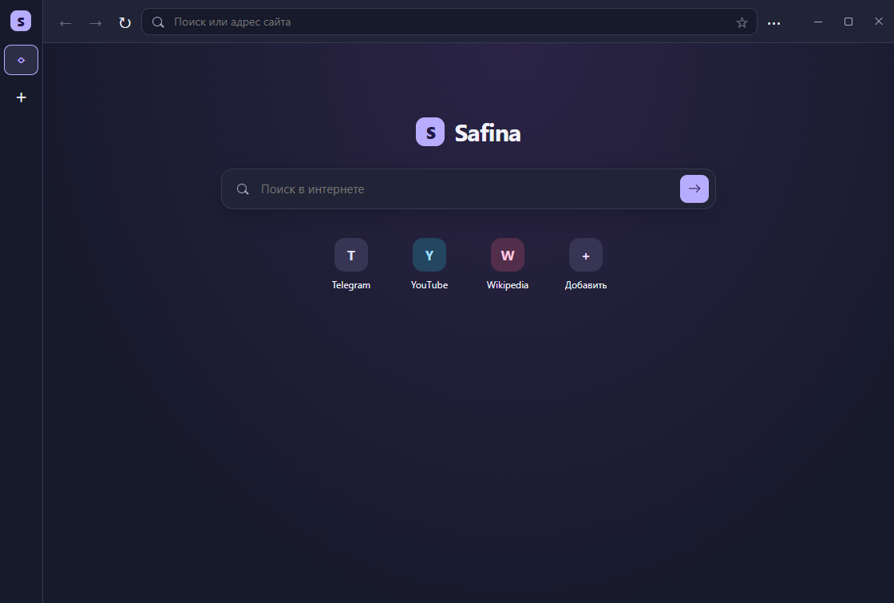
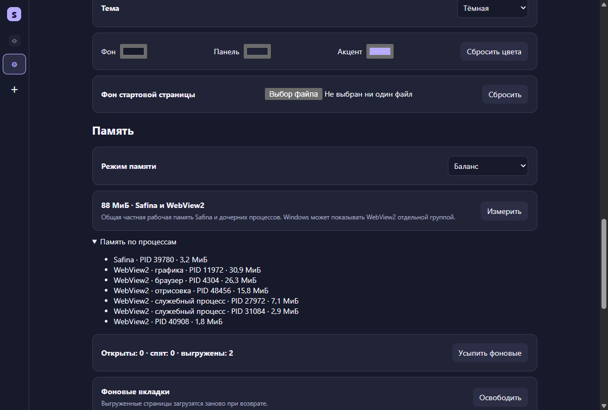

# Safina Browser

**Браузер для Windows x64 на Rust с упором на экономию оперативной памяти.** Интерфейс и управление вкладками написаны для Safina, а сайты открываются через Microsoft WebView2 на базе Chromium.

[Установщик Safina для Windows](https://github.com/qxxless/safina-browser-downloads/releases/download/v0.6.24/Safina-Setup-0.6.24-x64.exe) · [Все версии](https://github.com/qxxless/safina-browser-downloads/releases) · [Диагностика и конфиденциальность](PRIVACY.md)

## Как запустить

1. Запустите `Safina-Setup-0.6.24-x64.exe`. Он установит Safina для текущего пользователя и добавит ярлык в меню «Пуск». Ярлык на рабочем столе можно выбрать во время установки.
2. При первом запуске выберите расположение вкладок, тему и режим памяти.
Установщик проверяет WebView2 и скачивает его через официальный компонент Microsoft только при необходимости. Для этого потребуется интернет. [Скачать WebView2 Runtime](https://developer.microsoft.com/en-us/microsoft-edge/webview2/#download-section)

Установщик распространяется без подписи издателя Windows. SHA-256 указан на странице релиза. При удалении через «Установленные приложения» профиль пользователя сохраняется.

## Браузер по умолчанию и обновления

Safina может открывать ссылки HTTP и HTTPS и локальные PDF. Нажмите **«Сделать по умолчанию»** в диалоге при запуске или **«Открыть настройки Windows»** в разделе **«О браузере»**. В Windows подтвердите выбор Safina для ссылок и отдельно для `.pdf`. В диалоге есть кнопка **«Напомнить позже»** и галочка **«Больше не показывать»**.

С версии 0.6.18 установленная Safina проверяет канал GitHub при запуске. Новые выпуски с подписью Safina скачиваются и устанавливаются после проверки подписи и хэша. В разделе **«О браузере»** видны состояние и прогресс загрузки. Там же можно запустить проверку вручную. Для перехода с 0.6.16 или 0.6.17 запустите свежий установщик.

Safina добавляется в автозагрузку текущего пользователя. Отключить автозапуск можно в разделе **«Автозагрузка приложений»** Диспетчера задач Windows.

## Как Safina экономит память

Safina может усыплять фоновые вкладки и выгружать их из памяти после простоя. Активные загрузки, вкладки со звуком и сайты с исключением защищены от автоматической выгрузки. В настройках есть три предустановки **«Экономия»**, **«Баланс»** и **«Быстрые вкладки»**. Там же можно вручную освободить память и посмотреть суммарную частную рабочую память Safina и её дочерних процессов WebView2.

Расход ОЗУ зависит от сайтов, числа вкладок и выбранного режима. Выгруженная вкладка загрузится заново при возвращении. Раздел **«Память по процессам»** показывает отдельные процессы Safina и WebView2 с PID и объёмом памяти.

### Safina и Edge на девяти вкладках

| Время простоя | Safina 0.6.24 | Microsoft Edge 158 | Разница |
| --- | ---: | ---: | ---: |
| Сразу после переключения вкладок | 175,8 МиБ | 376,7 МиБ | 200,9 МиБ |
| 30 секунд | 130,8 МиБ | 255,7 МиБ | 124,9 МиБ |
| 90 секунд | 111,9 МиБ | 246,0 МиБ | 134,1 МиБ |

Через 90 секунд простоя Safina использовала примерно на **55% меньше памяти** в этом прогоне.

В каждом браузере открыли девять одинаковых локальных тестовых страниц с имитацией переписки. Использовали чистые профили, стандартные настройки памяти и одну и ту же активную вкладку. Замеряли суммарную частную рабочую память процессов каждого браузера, включая дочерние процессы WebView2 у Safina. ПК с Windows 11 26H2, Intel Core i5-12400F и 16 ГиБ ОЗУ. Это один прогон на синтетической нагрузке. На реальных сайтах результаты могут отличаться.

*Раздел «Память браузера» в отдельном демонстрационном профиле.*

## Возможности

| Раздел | Что умеет Safina |
| --- | --- |
| Вкладки | Вертикальная панель сворачивается до значков. Вкладки также можно разместить сверху или снизу. Нажатие колёсика закрывает вкладку. В меню правого клика есть дублирование, отключение звука, закрепление и восстановление. |
| Организация | Рабочие пространства, сохранённые наборы вкладок, закладки и ярлыки на стартовой странице. |
| Повседневная работа | История, загрузки, поиск по странице и восстановление сессии. Профиль, куки и настройки сохраняются на этом ПК. |
| Внешний вид | Светлая, тёмная и системная темы, настройка цветов и масштаб отдельных сайтов. |
| Фильтрация | Встроенный фильтр блокирует запросы к известным рекламным доменам. Для отдельных сайтов можно задать исключения. |
| Расширения | Можно загрузить распакованное расширение из папки с `manifest.json`. Совместимость зависит от расширения. |
| Gemini | Чат с локальной историей и экспортом в Markdown. Выделенный текст можно перевести или отправить в панель ИИ. Для Gemini нужен свой API-ключ. |
| Импорт и экспорт | Импорт HTML-закладок из Edge и Chrome, экспорт закладок и списка открытых сайтов. |

## Горячие клавиши

| Действие | Клавиши |
| --- | --- |
| Новая, закрыть или вернуть вкладку | `Ctrl+T` / `Ctrl+W` / `Ctrl+Shift+T` |
| Следующая или предыдущая вкладка | `Ctrl+Tab` / `Ctrl+Shift+Tab` |
| Переключение между двумя последними вкладками | `Ctrl+F2` |
| Адресная строка и поиск по странице | `Ctrl+L` / `Ctrl+F` |
| История и загрузки | `Ctrl+H` / `Ctrl+J` |

## Диагностика и отзывы

Safina может отправлять разработчику счётчики сбоев, общую память и число вкладок по состояниям. Отправку можно отключить на экране первого запуска или в разделе **«Отзывы и ошибки»**. Адреса и названия сайтов в отчёты не входят. Текст отзыва отправляется только по кнопке «Отправить отзыв» или «Отправить ошибку». Запись также можно сохранить на этом ПК и экспортировать вручную. [Подробнее о диагностике](PRIVACY.md)

При сообщении о баге укажите версию Safina, версию Windows и шаги, на которых он повторяется. Версию браузера и локальную сводку можно посмотреть в разделе **«О браузере»**.

Этот репозиторий содержит публичные сборки и документацию Safina.
